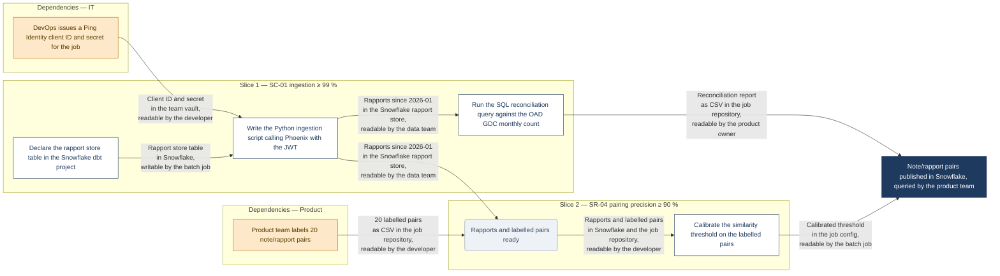

# Activity dependency DAG

**Step "Task splitting" of the delivery flow.** EPIC + Technical specification in, one Mermaid file out.

The file is the input of slice grouping and ticket writing, so it must be readable by someone who holds nothing but the two documents and the graph.

Every quality control point (QPC) is a gate: the graph is not delivered while one fails, unless the author has explicitly left it blank.

> The graph answers one question: in which order, and with what in hand, does the team carry out the work the specification describes, and at which points can a verifiable criterion be checked.

## Inputs

| Document | Format | What it brings |
|---|---|---|
| EPIC | `epic-writer` | Deliverable table, Requirements FR/NFR, Success criteria SC, DEPENDENCIES rows |
| Technical specification | `target-specification` | Diagrams under `docs/architecture/`, Requirements table with its Verification and Pass condition columns |

Without the Technical specification, stop and run `target-specification` first.

## Procedure

### 1. Read inputs

Extract from the two documents:

- every element tagged `#new` or `#changed`, and every relation the team implements → one or more activities each;
- every SR row → its Verification and Pass condition are the verifiable criteria;
- every external element and every EPIC DEPENDENCIES row → candidate dependencies.

### 2. Derive activities

One activity per task a developer can pick up and finish: build an element, implement a relation, run a verification, calibrate, backfill.

**Name**: `<action verb> <object>`, imperative. The verb says how the work is done; the object says what comes out.

| Write | Not |
|---|---|
| Write the Python ingestion script calling Phoenix | Implement ingestion |
| Declare the pair table in the Snowflake dbt project | Create the table |

Weasel verbs name no technique and no artefact: implement, create, set up, handle, manage, process, build, do, make.

**Output**: a named deliverable, one of:

- an artefact (a table, a job, an endpoint, a test report) located where it stands and by whom it is reachable: "pair table in Snowflake, readable by the data team", "reconciliation report as CSV in the job repository, readable by the product owner";
- a state: "developer can access the dev environment".

### 3. Grill

Use AskUserQuestion for every question; never ask in free text. Two calls at most.

| Call | Offer | Author confirms |
|---|---|---|
| **Dependencies** | The candidate list | For each one: the owner, the dependency type (IT, Product, Data, Security, Legal, other named by the author), the action the owner performs, the deliverable the team receives. A dependency with no owner is kept with owner "to identify". |
| **Slices** | A cut: one slice per verifiable criterion that can be checked once a group of activities is done, in checkable order | Merges, splits or renames |

### 4. Build the graph

Follow the [Format](#format) below.

- Add an edge only when the target cannot start without the source's deliverable.
- Add a join node only where two or more edges feed the same node.
- Remove any node no edge touches: an unconnected node is not needed in the DAG.
- Close the graph with one end node, the EPIC's final deliverable; every activity whose deliverable no later activity consumes feeds it. An activity that reaches neither a later activity nor the end node is a dead end: connect it or remove it.

### 5. Parallelisation review

Spawn one agent (`Agent`, general-purpose) with the Mermaid file and the two input documents. Brief it to report, not edit, and to list:

- every edge that is not a true artefact dependency (the target could start without the source's deliverable);
- every pair of activities drawn in sequence that could run side by side;
- every join node with fewer than two inputs.

Apply every finding. Where a finding contradicts an author answer, keep the author's answer and note it in the reply.

### 6. Validate

Check every [QPC](#qpc) gate below. Then check the syntax:

- Mermaid CLI available (`mmdc`) → render the file once to catch syntax errors;
- otherwise → check by reading that every node id is declared once and every edge references declared ids.

### 7. Output

The Mermaid file only, at `docs/specification/<epic-slug>-activity-dependency-dag.mmd`.

The file starts with `flowchart LR` and holds nothing but Mermaid: no Markdown fence, no prose, no comment other than `%%` lines naming the slice criterion when the subgraph title cannot hold it.

## Format

### Example



### Direction

`flowchart LR`. Nothing else precedes the first `subgraph`.

### Activity node

```
Ax["<verb> <object>"]:::activity
```

- One task, imperative verb first.
- The verb names the technique, the object names the artefact: Write the Python script…, Declare the Snowflake table…, Run the SQL query…, Calibrate the threshold on…, Backfill the months…, Publish the Metabase question….

### Dependency node

```
Dx["<owner> <verb> <object>"]:::dependency
```

- The owner is a role or team, the verb is what they do, the object is what they act on, with the same precision as an activity: "DevOps issues a Ping Identity client ID and secret" rather than "DevOps provides access".
- Every dependency node sits in a `subgraph DEP_<TYPE>["Dependencies — <Type>"]`, one subgraph per dependency type.
- No dependency node sits inside a slice.

### Join node

```
Jx("<combined state>"):::join
Jx{"<combined state>"}:::join
```

- Used only where two or more edges would otherwise feed the same node.
- The label names what is in hand once all inputs arrived.
- A join node sits in the slice of the node it feeds.

### End node

```
GOAL["<final deliverable of the EPIC>"]:::goal
```

- Exactly one per graph, declared after the last slice, outside any subgraph.
- The label names what the EPIC delivers, with the same precision as an edge label: the artefact or state, where it stands, who uses it.
- Every activity or join node with no later consumer feeds it; it has no outgoing edge.

### Edge

```
source -->|"<deliverable>"| target
```

- The label is the output of the source node: a named artefact with its location and its audience (`<artefact> in <system or place>, <readable|writable|runnable> by <role>`), or a state the target can rely on.
- The label breaks with `<br>` every three or four words so no renderer truncates it.
- A dependency's edge names what the team receives ("Developer can access the dev environment"), not the request.
- A node with several outgoing edges repeats its deliverable on each.

### Slice subgraph

```
subgraph Sn["Slice n — <criterion id> <criterion in five words>"]
```

- Slices read in checkable order.
- The criterion is an SR Pass condition or an EPIC SC.
- Every activity sits in exactly one slice.

### Quoting and identifiers

- Every label, edge label and subgraph title is wrapped in double quotes, so `≥`, `/`, `%`, parentheses and dashes render.
- No node text in the file beyond the labels above.
- Node identifiers are `A`, `D`, `J` plus a number, and `GOAL` for the end node.
- Subgraph identifiers are `S` plus a number, or `DEP_` plus the type.

## QPC

### Nodes

| ID | Gate |
|---|---|
| N1 | Every activity label starts with an action verb in the imperative and names one task; no label with "and" between two tasks. |
| N2 | Every dependency label reads `<owner> <verb> <object>`, carries `:::dependency`, and sits in a `DEP_` subgraph of its type; no dependency sits in a slice. |
| N3 | Every join node has at least two incoming edges and at least one outgoing edge; several targets that need the same combined state share one join. |
| N4 | Every node id is declared once; no node is declared outside a subgraph, except `GOAL` and join nodes placed next to the node they feed when the slice would otherwise read wrong. |
| N5 | No weasel verb in any label: implement, create, set up, handle, manage, process, build, do, make, provide, deliver, support, ensure. The verb says how (write, declare, run, calibrate, backfill, publish, configure with a named tool, issue, grant, sign) and the object says what artefact or state results. Applies to activities, dependencies and edge labels alike. |
| N6 | Every node has at least one edge touching it. A node with no edge is not needed in the DAG and is removed, join nodes included. |

### Edges

| ID | Gate |
|---|---|
| E1 | Every edge carries a label naming a deliverable: an artefact or a state, never a verb phrase describing work. |
| E2 | Every edge label is the output of its source node; a dependency's label is what the team receives. |
| E3 | No edge exists whose target could start without the source's deliverable (confirmed by the parallelisation review). |
| E4 | The graph is acyclic; every activity has at least one incoming edge or is a root with nothing to wait for. |
| E5 | Every artefact named in an edge label says where it stands (the system, store, repository or tool that holds it: a table in Snowflake, a CSV in S3, a page in Notion, a job in the git repository) and by whom it is accessible (the role that can read, write or run it). "A table" or "the report" alone fails the gate. |
| E6 | Every edge label is wrapped with `<br>` every three or four words; no run of more than four words without a break, and no label on a single line beyond four words. |
| E7 | Exactly one `GOAL` node, and every activity and join node reaches it through outgoing edges. A node with no outgoing edge other than `GOAL` is a dead end: its deliverable serves nobody, so it is connected to a consumer or removed. |

### Slices

| ID | Gate |
|---|---|
| S1 | Every slice title names one criterion id (SR-xx or SC-xx) that becomes checkable when every activity in the slice is done, and nothing in a later slice is needed to check it. |
| S2 | Every P1 requirement of the EPIC has at least one slice whose criterion proves it. |
| S3 | Every activity sits in exactly one slice; slices read in checkable order from left to right. |

### Output

| ID | Gate |
|---|---|
| O1 | One file, named `<epic-slug>-activity-dependency-dag.mmd`, holding Mermaid only, starting with `flowchart LR`. |
| O2 | The parallelisation review ran and its findings are applied or, when overridden by an author answer, named in the reply. |
| O3 | The file renders (Mermaid CLI) or passes the read check in step 6. |

## Guards

- Never invent an owner, a deliverable, a criterion or an activity the specification does not imply. Blank beats guessed: a dependency with no owner reads "to identify".
- Keep the specification's element names and the EPIC's terms in labels.
- Deliver the file, not an explanation of it. The reply names the file, the number of activities, dependencies and slices, and any review finding overridden by the author.
